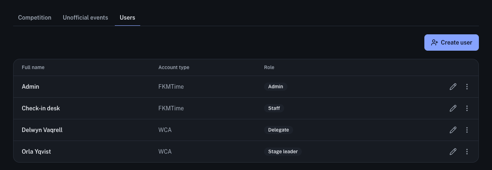
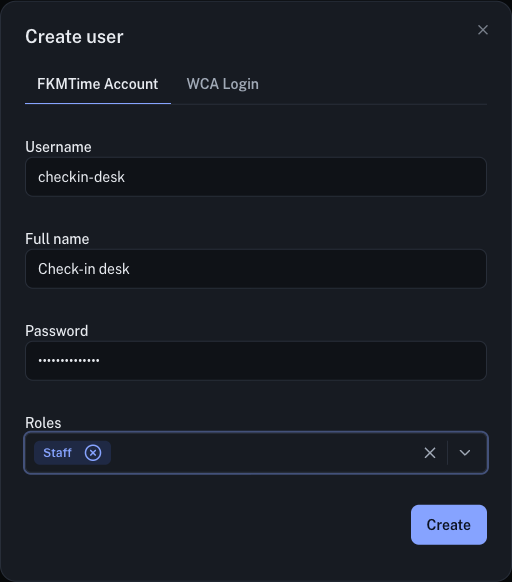
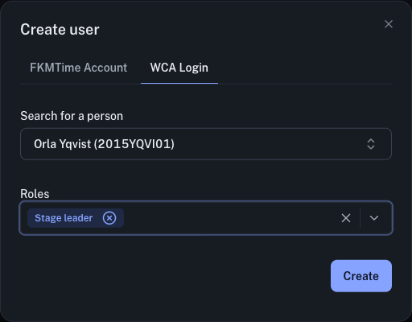

# Accounts

You can sign in to FKMTime with a WCA account or with an FKMTime account (username and password).

Delegates and organizers of the competition should sign in with their WCA accounts. FKMTime gives them their role automatically: a WCA Delegate of the competition becomes **Delegate**, any other person who manages the competition on the WCA website becomes **Organizer**. Roles are checked again on every WCA sign-in.

But sometimes, you want for example Competition Volunteer to check-in competitors. You have to create an FKMTime account for them OR add their WCA account to the system.

## Roles

| Role | What they can do |
|------|------------------|
| **Staff** | View the panel, check in competitors and assign cards |
| **Stage leader** | Staff, plus attendance and marking competitors as not coming |
| **Organizer** | Stage leader, plus devices, setup (competition settings, users, unofficial events), adding persons and running groups |
| **Delegate** | Organizer, plus incidents, scrambles, all results tools, tutorial mode and running a different round on a station |
| **Admin** | Everything, including server logs, device logs and uploading firmware |

You can't give anyone a role higher than your own: an organizer can't create delegates or admins.

## Creating an account

Users can be added after the competition is imported. Go to **Setup** → **Users** and click **Create user**. Choose between the **FKMTime Account** and **WCA Login** tabs.

### FKMTime Account

Fill in **Username**, **Full name**, **Password** and **Roles** and click **Create**. User will be able to sign in with the username and password you provided.

### WCA Login

Search for a person, select roles and click **Create**. User will be able to sign in with their WCA account and will have the roles you selected.

## Managing accounts

Each user in the list has actions to **Edit user** (roles, and username and full name of FKMTime accounts), **Change password** (FKMTime accounts only) and **Delete user**.

When a password changes, every session signed in with the old password ends. Users who are deleted or whose roles change are disconnected within a few seconds and see the panel with their new access.

Users with an FKMTime account can change their own password on the **Settings** page.

## Access to competition

If someone who signs in with a WCA account doesn't manage the competition and wasn't added on the Users page, they can't sign in ("You are not allowed to manage this competition"). Add them as delegate/organizer on the WCA website (FKMTime checks it with the WCA on every sign-in), or add their WCA account as described above.
