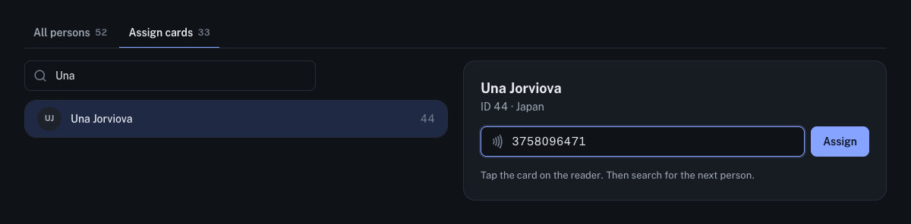
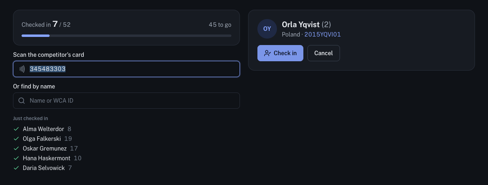
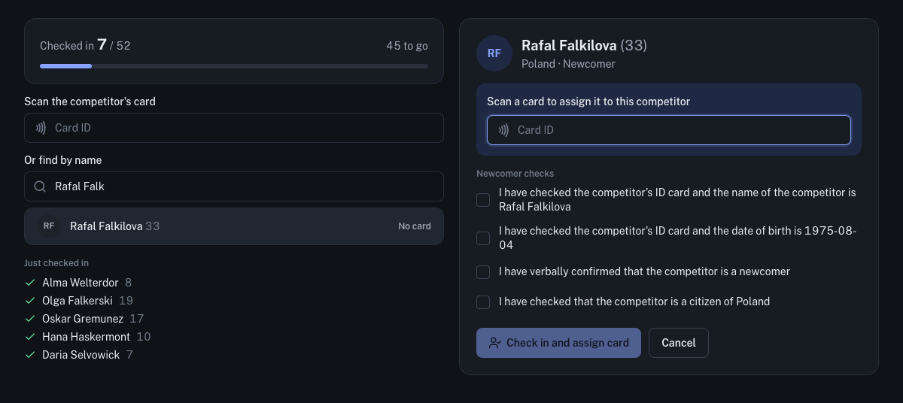

# Assigning cards & check-in

## Assigning cards

### Buy proper cards

You will need to buy RFID cards with 13.56 MHz frequency.

### Assign cards to the competitors

Go to the **Persons** page and open the **Assign cards** tab. It lists only people without a card, and the search is ready to type in.

Search for the competitor, pick them, scan the card you want to assign to them (it fills the **Card ID** field) and press Enter or click **Assign**. Search for the next competitor and repeat the process.

To assign or change the card of one person, use **Assign card** in their row on the **All persons** tab.

## Check-in

FKMTime has a check-in system that allows you to keep track of who is present at the competition and got their ID (or any other things).

To start, go to the **Check in** page. It shows how many competitors are already checked in.

### Cards assigned before the competition

If you assigned cards to the competitors before the competition, just scan the competitor's card. Their details open; press Enter or scan the same card again to check them in.

### Cards not assigned before the competition

If you didn't assign cards to the competitors before the competition, search for the competitor by name or WCA ID, scan a card to assign it to them, and click **Check in and assign card**.

### Newcomers

If you are checking in a newcomer, you have to check that their data matches their document (passport, driver's license, etc.). FKMTime shows the **Newcomer checks** list: name, date of birth, that they are a newcomer, and citizenship. You have to tick every check before you can check them in.

After each check-in you can undo it, and the most recent check-ins are listed under **Just checked in**.
