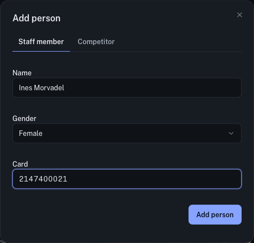
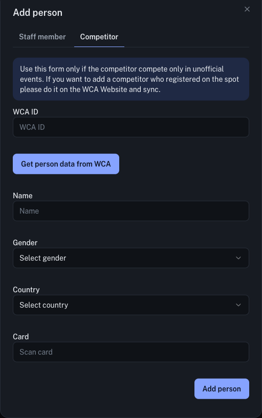

# Competition Volunteers

Go to the **Persons** page and click **Add person** (organizers and delegates).

## Adding Competition Volunteer to the system

Choose the **Staff member** tab, fill in the form and click **Add person**. You can also assign a card to them (read more about assigning cards [here](/basic-knowledge/assigning-cards)).

To let a volunteer sign in to the panel, create an account for them, see [Accounts](./accounts.md).

## Adding a competitor competing only in unofficial events to the system

If you want to add a competitor who is competing only in unofficial events, choose the **Competitor** tab and fill in the form. You can get their data from the WCA by entering their WCA ID and clicking **Get person data from WCA**. You can scan their card here as well.

:::warning
Use this form only for competitors competing only in unofficial events. If you want to add a competitor who registered on the spot, do it on the WCA website and click **Sync with WCA** in **Setup** → **Competition**.
:::
