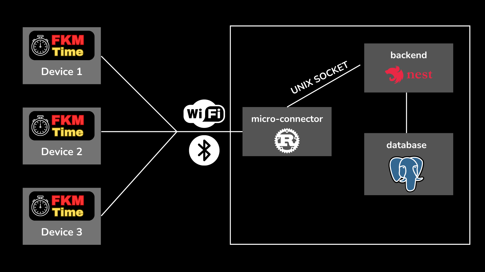

# How FKMTime works?

Basically, there are:
- Backend: Nest.js
- Frontend: React (served by nginx in production)
- Database: PostgreSQL
- Micro-connector: Rust
- FKMTime Devices (esp-hal / Rust)

Communication between devices and backend looks like this:

