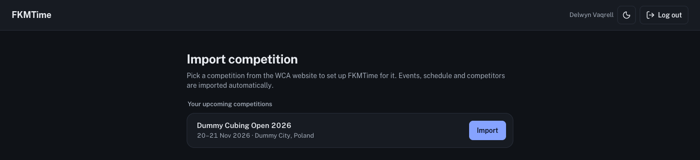
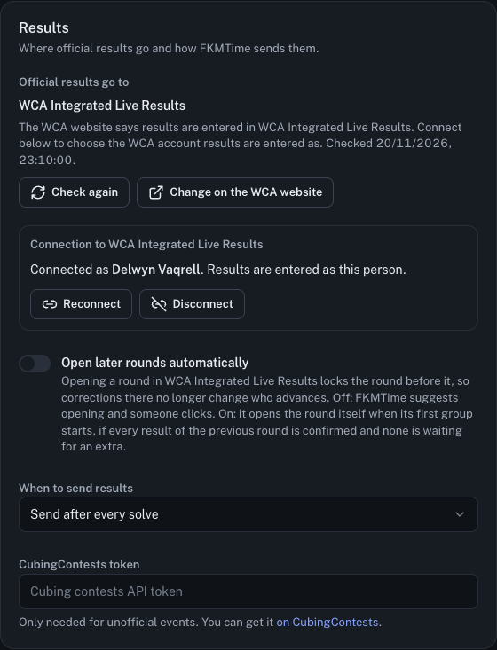
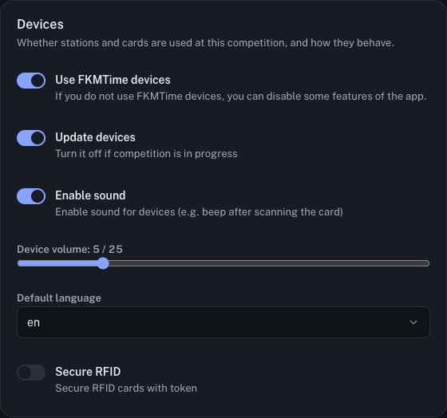

# Importing competition

:::important
It is recommended to import competition after creating groups.
:::

To import a competition, you need a WCA account that manages the competition you want to import.

After first login to the system, you will be redirected to the **Import competition** page. It lists **Your upcoming competitions**; click **Import** next to the one you want. Events, schedule and competitors are imported automatically.

After the import you will be redirected to the competition settings: **Setup** → **Competition**. If you change something on the WCA website later (for example groups or registrations), click **Sync with WCA** at the top of this page.

## Competition settings

The settings are split into cards. After changing anything, click **Save** in the bar at the bottom of the page.

### Results

FKMTime sends official results where the competition's scoretaking setting on the WCA website says. **Official results go to** shows what it is: **WCA Live**, **WCA Integrated Live Results** or **Nowhere**. To change it, use **Change on the WCA website**, then click **Check again**.

#### WCA Live

You will need a scoretaking token that can be taken from WCA Live. Go to the [account](https://live.worldcubeassociation.org/account) page and generate one. This token may expire after 7 days and is specific to the selected competition. Paste it into the **Scoretaking token** field.

FKMTime reminds you at the top of the page if the token is missing or may have expired.

#### WCA Integrated Live Results

Click **Connect to WCA Integrated Live Results** and sign in with a WCA account that can enter scores for the competition. Results will be entered as this account. You can add more scoretakers by WCA ID in the **Scoretakers** card.

Turn on **Open later rounds automatically** if FKMTime should open later rounds itself. Otherwise FKMTime suggests opening them and a person confirms, because opening a round locks the round before it.

#### When to send results

By default, results are sent after every solve (**Send after every solve**). If the internet connection in the venue is not stable you can choose **Send active rounds results every 5 minutes**, or turn sending off completely with **Do not send** (for testing purposes).

#### Cubing Contests

If you plan to host [unofficial events](./unofficial-events.md) and want to send results automatically to Cubing Contests, copy the token from Cubing Contests and paste it into the **CubingContests token** field.

### Network

The Wi-Fi network that FKMTime devices join, and how they find the server. See [Adding devices](./adding-devices.md).

### Competition day

**Change groups automatically**, see [Selecting current group](./selecting-event.md).

### Devices

- **Use FKMTime devices** - turn it off if you use FKMTime without stations (for example only for check-in); pages that need devices are then hidden
- **Update devices** - see [How updates work](./how-updates-work.md)
- **Enable sound**, **Device volume** - sounds of the stations
- **Default language** - language of the messages shown on the stations
- **Secure RFID** - secure RFID cards with a token

