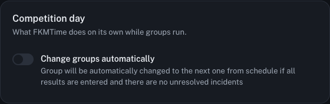
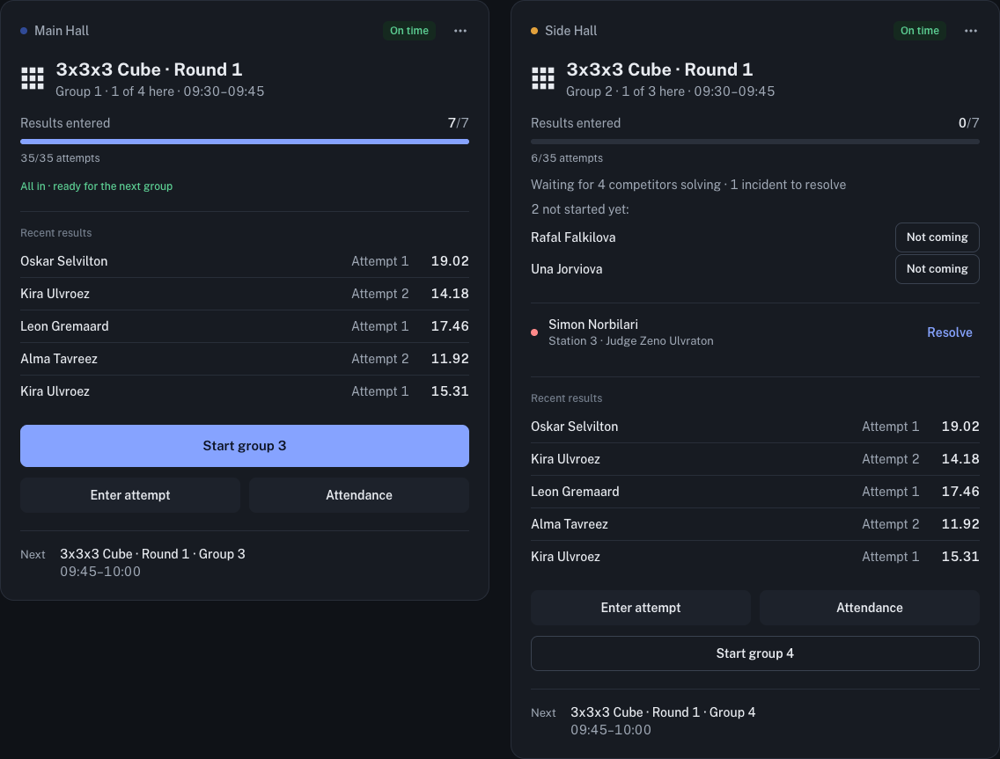
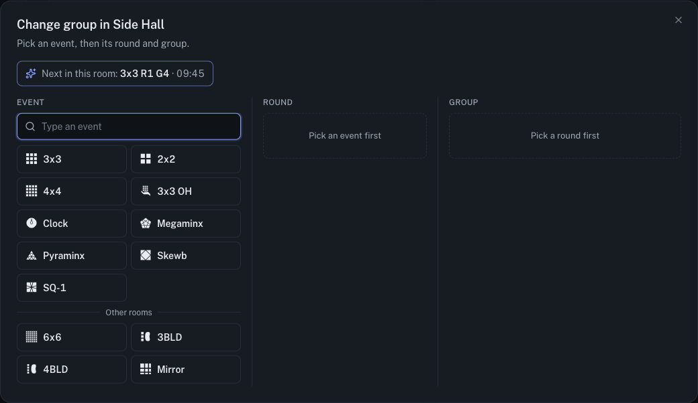
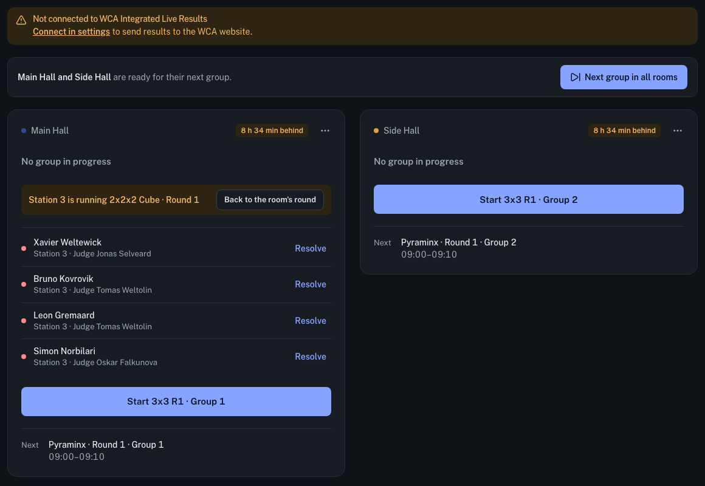

# Selecting current group

FKMTime needs to know which group is currently taking place in each room in order to enter results to the correct round. You run the groups of each room from the **Home** page, which has a card for every room.

## Changing groups automatically

You can opt for doing it automatically, by turning on **Change groups automatically** in **Setup** → **Competition** (the **Competition day** card). If so, the group will be automatically changed to the next one from the schedule once all its results are entered and there are no unresolved incidents. Competitors marked as **Not coming** don't hold the group up.

## Changing groups manually

Although it is recommended to turn on **Change groups automatically**, you are not forced to do so. Organizers and delegates can start groups from the room's card on the **Home** page.

The card shows the running group, how many results are entered, what the group is still waiting for, and the room's next group from the schedule under **Next**. Once the running group is done, click the start button (for example **Start group 2**, or **Start 3x3 R2 · Group 1** when the next group is in another round) and confirm. Stations in the room switch to the new group right away.

When two or more rooms are ready, **Next group in all rooms** starts the next group in each of them at once.

The room's **More** (…) menu has:

- **Change group…** - pick any event, round and group. You can also run several groups in one room at the same time (**Run both**), for example when holding multiple events at the same time
- **Back to the previous group**
- **Give delegate access…** (delegates only) - let someone resolve the incidents of the room's running or next group, see [Delegate access for one group](../during-the-competition/delegate-access.md)
- **Stop** a single group, when the room runs several of them
- **Stop the room**

## Opening rounds

Results can only be entered once their round is open on the results website:

- **WCA Live** - after a group starts a new round, FKMTime reminds you to open the round in WCA Live.
- **WCA Integrated Live Results** - FKMTime opens first rounds itself. Later rounds are opened automatically if **Open later rounds automatically** is on in the competition settings. Otherwise FKMTime asks you to open them, and the **Home** page warns about rounds that aren't open yet.

## Home page alerts

Above the room cards, the **Home** page shows alerts when something needs doing. Organizers and delegates see them, except **No delegate free**, which only delegates see. The buttons that start or end tutorial mode are for delegates.

- **Tutorial for new competitors** (or the name of the schedule's tutorial activity) - from 15 minutes before a tutorial in the schedule until it ends, suggests putting a station in tutorial mode, so newcomers can try a solve without anything being saved. **Start tutorial** (or **Start tutorial on** a station) starts it; the × (**Dismiss**) hides the suggestion.
- **… is in tutorial mode** / **N stations are in tutorial mode** - stations whose solves aren't saved. **End tutorial** takes a station out of tutorial mode.
- **No delegate free for …** / **No delegate free for N groups** - every delegate competes in a running or next group. **Give delegate access…** lets someone else resolve that group's incidents, see [Delegate access for one group](../during-the-competition/delegate-access.md).
- **N competitors didn't come to …** - with WCA Integrated Live Results, a finished round lists competitors who never came. Until they're removed there, the next round can't open. Untick anyone allowed to compete late and click **Remove from … in WCA Integrated Live Results**.
- **Not connected to WCA Integrated Live Results** (or **WCA Integrated Live Results disconnected**) - results can't reach the WCA website. **Connect in settings** (or **Reconnect in settings**) opens the settings.
- **Some results aren't reaching WCA live results** - per round, results still sending after a few minutes or not taken. Each round links to its results, where every result says why.

Each room card shows, besides the running group and its progress:

- **Incidents** - the room's open incidents, each with **Resolve** (delegates only)
- **Recent results** - the latest attempts entered in the room
- stations of the room that run another round (**… is running …**), with **Back to the room's round** (delegates only)
- what the group is waiting for: competitors still solving, incidents to resolve, extras to do, and who hasn't started yet, with **Not coming** for those who take attendance in the room. When the room moves on by itself, it also says when
