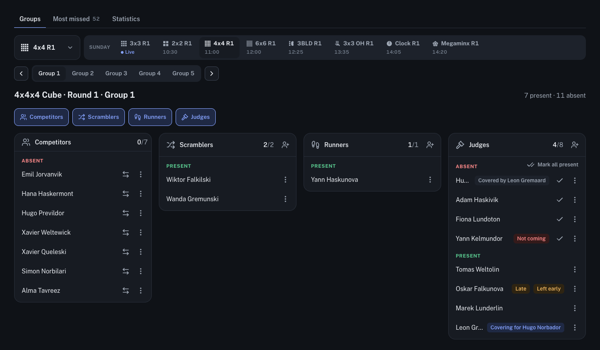
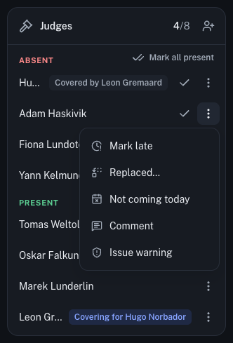
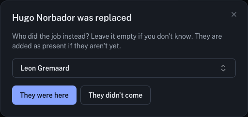
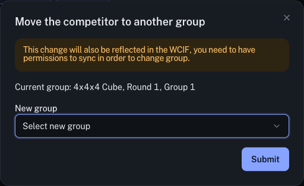
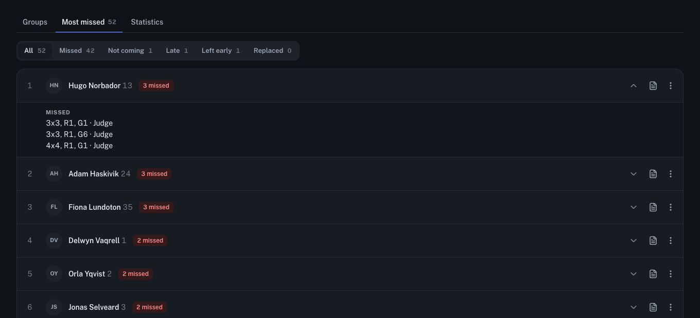
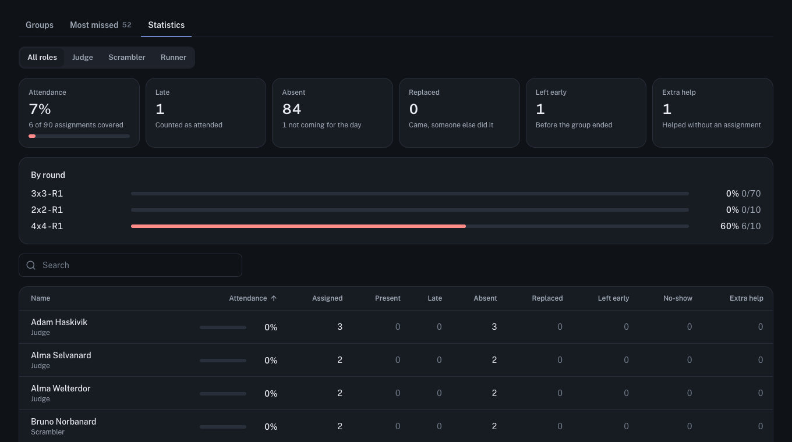

# Attendance

The **Attendance** page is where you check who turned up for each group: competitors, scramblers, runners and judges. It has three tabs: **Groups**, **Most missed** and **Statistics**.

:::info Who can use it
Stage leaders, organizers, delegates and admins. A stage leader takes attendance only in the rooms they're given, see [Stage leaders and rooms](../basic-knowledge/accounts.md#stage-leaders-and-rooms). Some actions need a higher role; they're marked below.
:::

## Opening a group

Open **Attendance** from the menu, or click **Attendance** on a room's card on the **Home** page. If exactly one room is running a group, the page opens on that group.

Choose a round from the strip at the top (rounds in progress show **Live**), or from the round list on its left (**Choose a round**). Then pick the group. A dot marks the group in progress. **Previous group** and **Next group** (the arrows on both sides) go through every group in schedule order, across rounds.

Above the cards you see how many people are present and absent in the group. The **Competitors**, **Scramblers**, **Runners** and **Judges** buttons show or hide each card. Your choice is remembered on this device. A role with nobody in the group stays hidden until you turn it on.

Each card shows how many people are present out of everyone in that role (e.g. **4/8**), and splits them into **Absent** and **Present**. The page updates live when someone else marks a person or a station checks a competitor in.

## Taking attendance for staff

For an absent scrambler, runner or judge, click **Mark present** (the tick). The menu (⋮) next to them has:

- **Mark late** - they did the job, but came late
- **Replaced…** - someone else did the job (see below)
- **Not coming today** - see [Not coming today](#not-coming-today)
- **Comment** - a note on this assignment
- **Issue warning** - delegates only

When a card has more than one absent person, **Mark all present** marks all of them at once.

For someone present, the menu has **Left early** (only for present or late; it reads **Didn't leave early** once set), **Comment**, **Issue warning** (delegates only) and **Mark absent**. Marking absent someone who wasn't assigned to the group removes them from the list, after you confirm.

After each change a message with **Undo** shows for a few seconds. Undo puts back what was there before.

### Replaced

**Replaced…** asks who did the job instead. Pick the person, or leave it empty if you don't know. Then click:

- **They were here** - the person came, but someone else did the job,
- **They didn't come** - the person stays absent, and the row shows **Covered by** the person who did it.

The person who did the job is added as present if they aren't yet, and their row shows **Covering for**.

### Badges

Rows show what applies to them: **Late**, **Left early**, **Replaced** / **Replaced by**, **Covered by**, **Covering for**, **Unassigned** (present without an assignment) and **Not coming**.

### Not coming today

When you hear that a staff member isn't coming, for example they're ill, choose **Not coming today** on one of their absent rows. FKMTime marks them as not coming in that group and in every group of theirs later that day that hasn't ended yet. Groups that are over keep what was recorded. Their rows show **Not coming** and drop to the bottom of the **Absent** list, so the people still expected stay on top.

**Coming after all** undoes it. Marking them present, or scanning their card, clears it for that group.

You can do the same from a person's page, next to each day of their schedule. A stage leader can mark someone as not coming if one of that person's groups that day is in their rooms; it applies to the whole day.

### Adding someone who wasn't assigned

To add a scrambler, runner or judge who wasn't assigned to the group, click the person icon in the card's header, pick the person and click **Add and mark as present**. If they compete in this group, FKMTime warns you and the button reads **Add anyway**.

### Judges at stations

A judge is marked present automatically when they sign an attempt with their card on a station in that group. If they weren't assigned, they're added as an unassigned judge. Once runners are assigned for the round, present judges show their station (e.g. **· Station 3**).

Scramblers and runners can also check in on an attendance device by tapping their card.

## Competitors

A competitor is marked present when an attempt of theirs in the group is entered, from a station or from the panel. You can't mark competitors present by hand.

In a later round, every competitor shows their place in the previous round in brackets, e.g. **(3)**, so you can tell whether a missing competitor matters.

For an absent competitor:

- **Change group** (the arrows) moves them to another group of the same round. Pick **New group**, click **Submit** and confirm. The change is written to the competition on the WCA website, and any other assignment they have during the new group is deleted. Only organizers and delegates who signed in with a WCA account can do it.
- **Not coming** marks them as not coming to this group only. FKMTime then doesn't wait for them before [changing the group automatically](../basic-knowledge/selecting-event.md#changing-groups-automatically). **Coming after all** undoes it, and an attempt from them clears it.
- **Remove from round** - organizers and delegates, in a later round when the competition sends results to WCA Integrated Live Results. FKMTime asks the WCA who is next in line, and you choose whether they advance.

## Most missed

The **Most missed** tab lists staff by how many assignments they missed, for the whole competition. Only groups that have started count as missed. **Not coming** assignments show even for groups still ahead.

Filter the list with **All**, **Missed**, **Not coming**, **Late**, **Left early** and **Replaced**. Click a person to see the groups behind each count and the comments on their assignments. **Groups** shows their assignments; delegates also have **Warnings** and **Issue warning**.

## Statistics

The **Statistics** tab shows staff attendance for the whole competition, counting only groups that have started.

- **Summary** cards at the top: **Attendance** (the share of assignments covered), **Late** (counted as attended), **Absent** (with how many are not coming for the day), **Replaced**, **Left early** and **Extra help** (people who helped without an assignment).
- **By round** - attendance per round.
- The table, one row per person, with columns **Name**, **Attendance**, **Assigned**, **Present**, **Late**, **Absent**, **Replaced**, **Left early**, **No-show** and **Extra help**. Click a column header to sort by it.

When more than one role has staff, choose a role at the top (**All roles**, **Judge**, **Scrambler**, **Runner**…) to see the numbers for that role only. Use the search box to find someone in the table.
