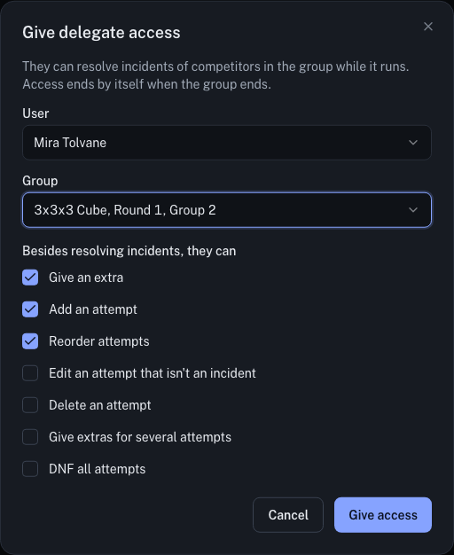
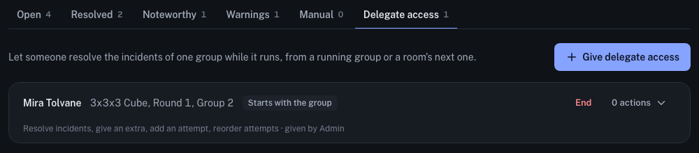
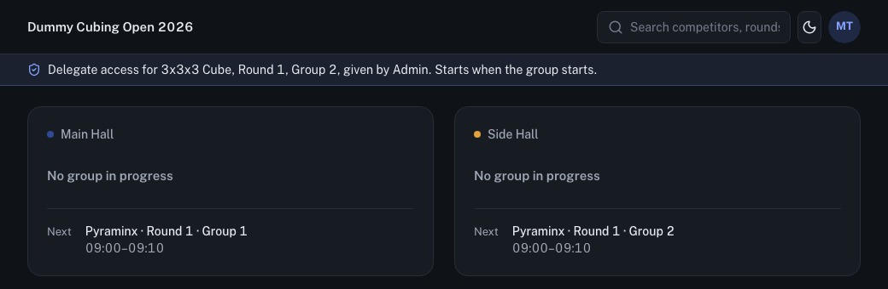

# Delegate access for one group

When no delegate is free for a group - for example, all delegates compete in it, or have to be somewhere else - incidents wait and competitors stand at the station. Instead of making someone a delegate for the whole competition, a delegate can give a user **delegate access** for one group: they can resolve that group's [incidents](incidents.md) while it runs, and the access ends by itself when the group ends.

:::note Who can use it
Delegates (and admins) give and end delegate access. It can be given to any existing user who isn't a delegate or admin; their roles don't change.
:::

## Giving delegate access

You can give access from three places. Each opens the same **Give delegate access** dialog:

- **Incidents** → **Delegate access** tab → **Give delegate access** - for any group running now or any room's next group
- **Home** → the room's **More** (…) menu → **Give delegate access…** - for the room's running and next groups
- **Setup** → **Users** → the user's row menu → **Give delegate access…** - with the user already chosen. It shows only for users who aren't delegates or admins

On **Home**, a **No delegate free for…** alert appears when every delegate of the competition competes in a running or next group. Its **Give delegate access…** button opens the dialog for that group. The alert goes away once someone has access for the group.

In the dialog, choose the **User** and the **Group**, tick what they can do besides resolving incidents, and click **Give access**.

## What they can do

Delegate access always includes resolving incidents: correcting the time, penalty, judge and comment of an incident and clicking **Mark as resolved**. Under **Besides resolving incidents, they can**, you choose the rest:

| Option | Ticked by default |
|--------|-------------------|
| **Give an extra** | Yes |
| **Add an attempt** | Yes |
| **Reorder attempts** | Yes |
| **Edit an attempt that isn't an incident** | No |
| **Delete an attempt** | No |
| **Give extras for several attempts** | No |
| **DNF all attempts** | No |

Whatever you tick, they can only act on competitors of that group: those assigned to it, and those who solved in it on a station in the room that runs it. Removing a result, double-checking, sending or resubmitting results, restarting a group and assigning DNS stay with delegates. So do warnings, noteworthy and manual incidents, and resolved incidents. A **DNF all attempts** that would also remove results from later rounds is refused.

Giving access again to the same user for the same group changes the options of the access they already have.

## When it starts and ends

- Given for a group that is running, access works straight away.
- Given for a room's next group, it waits (**Starts with the group**) and starts when a room starts the group.
- It ends by itself when the group stops running, for example when the room moves to the next group. Ended access never comes back, even if the group is started again; give access again if needed.
- To end it early, click **End** on the **Delegate access** tab and confirm with **End access**.

## What they did

The **Delegate access** tab lists the access that hasn't ended, then the access that ended today. Each row shows the user, the group, its state (**Active**, **Starts with the group** or **Ended**), what it allows and who gave and ended it.

Click the number of actions (for example **3 actions**) to see what the user did: the time, the competitor (linking to their result) and what changed. The list updates live, so you can look over their decisions while the group runs.

## What the user with access sees

A banner across the panel says which group the access is for and who gave it, and whether it **Starts when the group starts** or **Ends when the group ends**. When the access ends, the banner says so for a few seconds.

They get **Incidents** in the menu with only the **Open** tab, showing the open incidents of their group. Buttons for actions their access doesn't include are hidden, and **Mark as noteworthy incident** and **Previous extras** don't show. If their access ends while they are working, saving fails with a message that it has ended, and the incident stays open for delegates.
