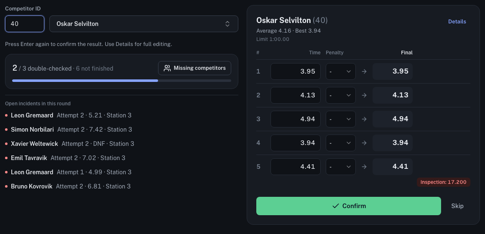
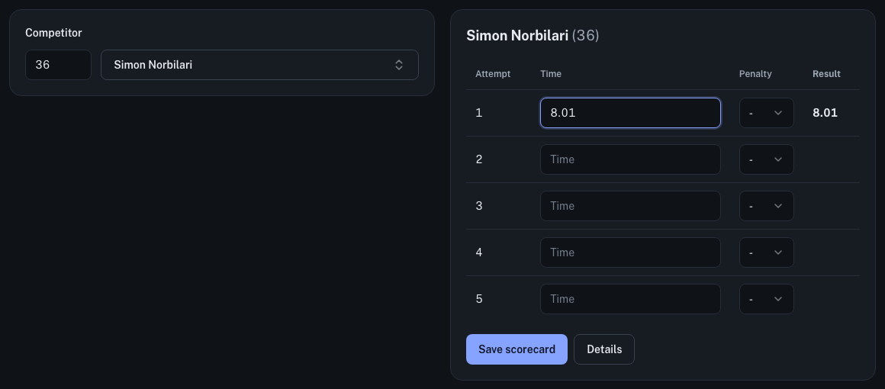

# Double check and scorecards

Paper scorecards are the backup for what the stations recorded. Two pages on a round's [results](results.md) work through them one scorecard at a time, with the keyboard: **Double check** compares the results with the scorecards, and **Enter scorecard** types a scorecard in.

:::note Who can use it
Delegates (and admins).
:::

Open a round on the **Results** page and click **Double check** or **Enter scorecard** above the table.

## Double check

1. Type the competitor's ID from the scorecard into **Competitor ID** (or pick them from the list next to it). Their result opens on the right: average, best, the time limit and cutoff, and each attempt with its **Time**, **Penalty** and the **Final** result.
2. Compare it with the scorecard. If something differs, correct the time or penalty right there. A time over the time limit becomes DNF.
3. Press Enter (or **Confirm**) to mark the result as double-checked. FKMTime saves it and sends it to the results website again; if you changed anything, it asks first.
4. Type the next ID.

- **Skip** leaves a result for later. **Details** opens the result, for anything you can't fix in the list (see [A single result](results.md#a-single-result)).
- The progress shows how many results are double-checked and how many are **not finished**: results still missing attempts or with an open incident. They can be double-checked once they're complete.
- **Missing competitors** lists the competitors of the round with no result yet.
- **Open incidents in this round** lists the round's incidents, each linking to the incident.
- A scorecard that was already double-checked says so when you type its ID.

When every result is double-checked, the page says **All N results double-checked**. **Mark results as not double checked** starts the round over.

## Enter scorecard

Use **Enter scorecard** when attempts were written only on paper, for example when a station didn't work.

1. Type the competitor's ID into **Competitor** (or pick them from the list). Their scorecard opens with every attempt of the round; attempts already in FKMTime are filled in. Press Enter to jump to the first time.
2. Type each **Time** and choose its **Penalty**. A time over the time limit becomes DNF.
3. Press Enter in the last time, or click **Save scorecard**. FKMTime confirms with **Saved … scorecard** and a link to **Open result**, and the cursor goes back to **Competitor** for the next one.

**Details** opens the competitor's result. If the competitor is waiting for an extra attempt, the scorecard can't be entered here; enter the attempts on their result instead.
