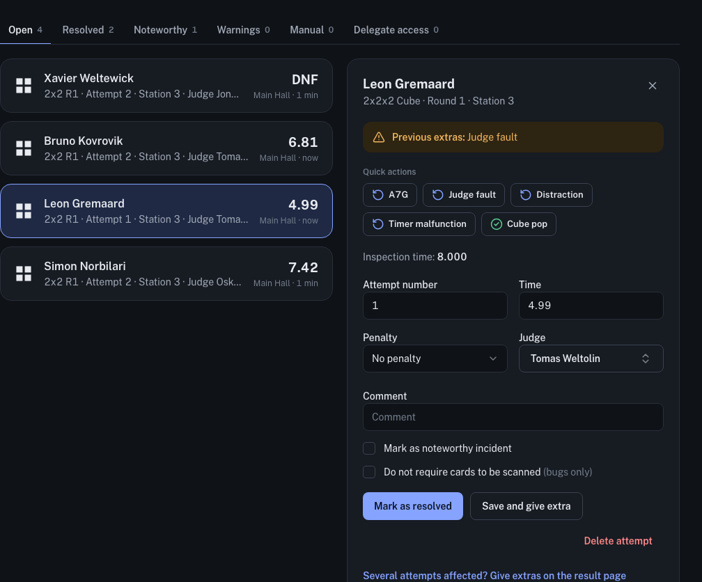
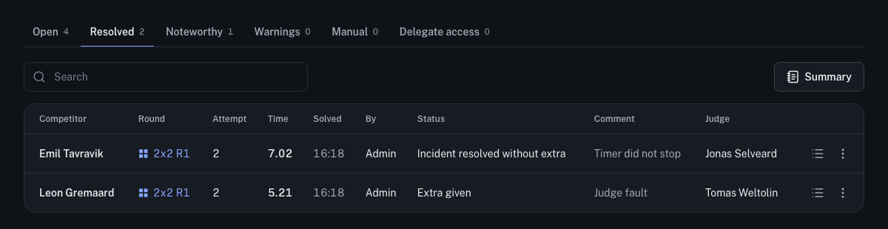
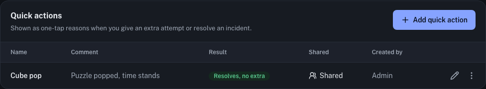
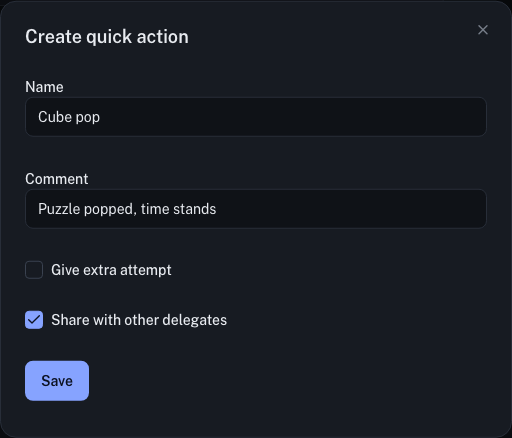

# Incidents

When something goes wrong during an attempt, the judge calls the delegate from the station. The attempt then waits on the **Incidents** page until a delegate decides what happens with it, and the station waits for that answer. Open incidents also hold the group: with **Change groups automatically** on, the next group doesn't start until they're resolved.

The **Incidents** item in the menu shows how many incidents are open.

:::note Who can use it
Delegates (and admins). Someone with delegate access for a group sees only the open incidents of that group, and only the actions their access includes.
:::

The page has these tabs: **Open**, **Resolved**, **Noteworthy**, **Warnings**, **Manual** and **Delegate access**. If the competition doesn't use FKMTime devices, only **Warnings** and **Manual** are there, and **Incidents** opens on **Manual**.

## Open

**Open** lists every incident waiting for a decision: the competitor, the round, the attempt number, the station, the judge, the time and how long ago it was solved. Click an incident to open it next to the list.

The incident shows:

- **Previous extras** - the competitor's earlier incidents in the competition, grouped by comment, so you can see if the same thing keeps happening
- **Quick actions** - one click resolves the incident with a ready comment. The built-in ones (**A7G**, **Judge fault**, **Distraction**, **Timer malfunction**) give an extra attempt; you can add your own (see [Quick actions](#quick-actions))
- **Inspection time**, as measured by the station
- **Attempt number**, **Time**, **Penalty** and **Judge** - correct them if the station got something wrong
- **Comment** - why you decided what you did; it shows in the **Resolved** tab and in the **Summary**
- **Mark as noteworthy incident** - also saves the incident to the **Noteworthy** tab
- **Do not require cards to be scanned** (bugs only) - normally, after an incident is resolved, the station asks for the competitor's and judge's cards again to confirm the result. Tick this only when the station can't get past that step

Then choose:

- **Mark as resolved** - the attempt counts with the time and penalty in the form. If the time is over the round's time limit, it's changed to DNF
- **Save and give extra** - the competitor gets an extra attempt in place of this one
- **Delete attempt** - removes the attempt completely, after you confirm

Your answer goes back to the station straight away. Unless you gave an extra, the result is sent to the results website.

When several attempts of a competitor are affected, follow **Several attempts affected? Give extras on the result page** to give the extras on the result's page.

### Tutorial incidents

When a station runs the tutorial for new competitors, its delegate calls show up in **Open** too, marked **Tutorial**. You answer them with the same quick actions, **Time**, **Penalty**, **Mark as resolved**, **Give extra** or **Delete**, but nothing is saved: the answer only goes back to the station. Tutorial incidents are for delegates only.

## Resolved

**Resolved** has every incident that was already decided: competitor, round, attempt, time, when it was solved, who resolved it (**By**), the outcome (**Status**), comment and judge. Use the search to find a competitor.

Each row has:

- **View attempts** - opens the competitor's result in that round
- **Copy incident info** - copies the competitor, their WCA ID and the round and attempt (e.g. `2x2 R1A2`), for a delegate report
- **Save as noteworthy** - adds the incident to the **Noteworthy** tab

**Summary** groups the resolved incidents by comment and shows for each one whether an extra was given, the attempt was a DNF, or the original time stands.

## Noteworthy

**Noteworthy** collects incidents worth mentioning in the delegate report. An incident marked as noteworthy is added here with the competitor and round as its title and the incident's comment as its description; you can also click **Add noteworthy incident** and write one yourself (**Title** and **Description**). Each one can be edited or deleted, and one saved from an attempt has **View attempts**.

## Warnings

**Warnings** lists the warnings given to competitors and who gave them. Click **Add warning**, choose the **Competitor** and describe what happened. You can also give a warning with **Issue warning** on the **Persons** page or on the **Attendance** page.

## Manual

**Manual** is for incidents that didn't come from a station. Click **Add manual incident** and fill in **Competitor**, **Event**, **Round**, **Attempt** and **Description**. Manual incidents can be edited or deleted.

If the competition doesn't use FKMTime devices, this is where **Incidents** opens.

## Quick actions

Besides the built-in quick actions, each delegate can add their own in **Settings** → **Quick actions**.

Click **Add quick action** and fill in:

- **Name** - the button's label in an incident
- **Comment** - saved as the incident's comment
- **Give extra attempt** - ticked, the action gives an extra; unticked, it resolves the incident and the time stands
- **Share with other delegates** - other delegates of the competition see the action too. Unshared, only you do

The list shows what each action does (**Gives extra** or **Resolves, no extra**) and whether it's **Shared** or **Only me**. Each action can be edited, shared or unshared, or deleted.
