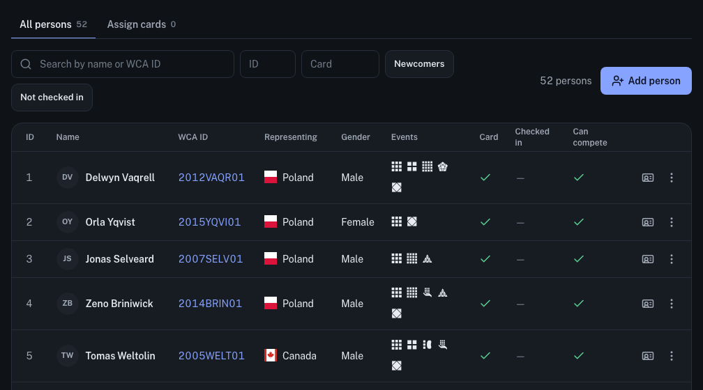
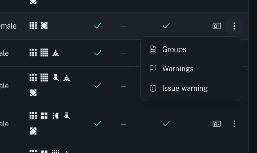
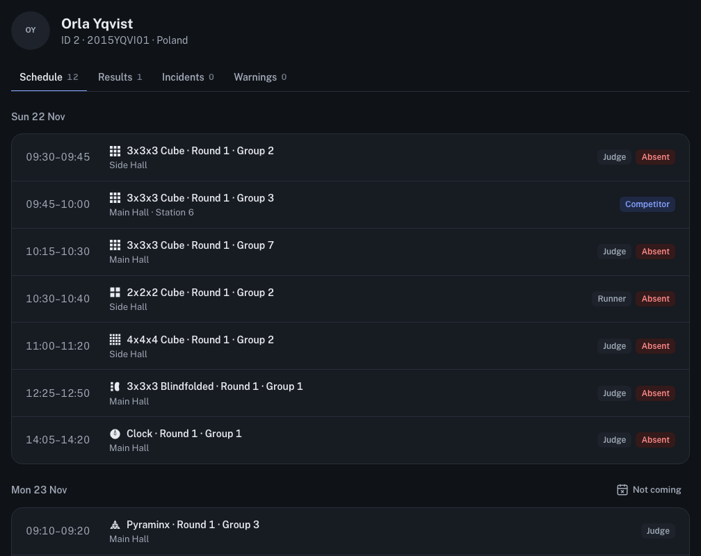
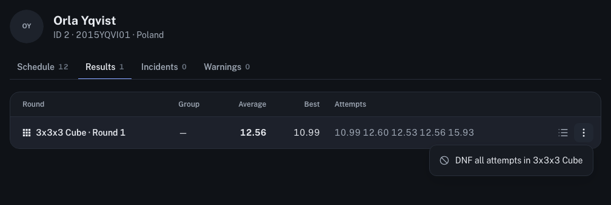
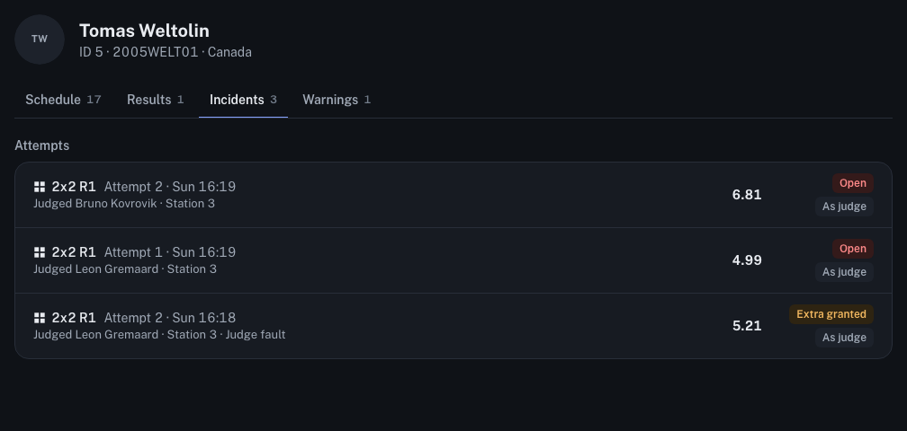
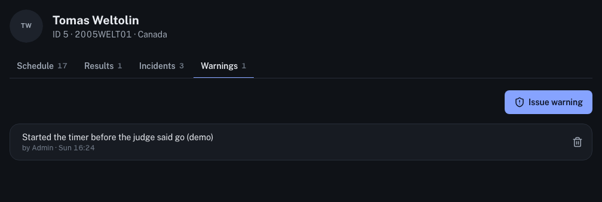

# Persons

The **Persons** page lists everyone in the competition: competitors from the WCA registration and anyone added in FKMTime. From a person's row you can assign their card, see their groups and handle warnings, and stage leaders and above can open a page for each person with their schedule, results, incidents and warnings.

Everyone signed in to the panel can see the list. What you can do with a person depends on your role (see [Accounts](../basic-knowledge/accounts.md)).

## The persons list

Use **Search by name or WCA ID** to find someone. Next to the search you can narrow the list down:

- **ID** - the person's registrant ID
- **Card** - the ID of a card, to find out whose card it is (only when the competition uses FKMTime devices)
- **Newcomers** - only competitors without a WCA ID
- **Not checked in** - only people who haven't checked in yet

On a phone these sit under **Filters**, with **Clear** to remove them all.

The list shows each person's registrant ID, name, WCA ID (or **Newcomer**), country, gender and events, and whether they are **Checked in**. With FKMTime devices it also shows whether they have a **Card** and whether they **Can compete**.

When the competition uses FKMTime devices, the page has two tabs: **All persons** and **Assign cards**. Assigning cards and checking in are described in [Assigning cards & check-in](../basic-knowledge/assigning-cards.md).

### Actions in a row

Each row has these actions, depending on your role:

- **Assign card** - assign or change the person's card (only with FKMTime devices).
- **Groups** - the person's groups: each group, what they do in it, whether they were present and whether they are assigned to it. Stage leaders, organizers and delegates.
- **Warnings** - the warnings the person got and who issued them. Delegates only.
- **Issue warning** - write a **Description** and click **Issue warning**. Delegates only.

**Groups**, **Warnings** and **Issue warning** are only there for people from the WCA registration, not for people added in FKMTime.

### Adding a person

Organizers and delegates can add a staff member or a competitor who competes only in unofficial events with **Add person** (only with FKMTime devices). See [Competition Volunteers](../basic-knowledge/competition-volunteers.md).

## A person's page

Stage leaders, organizers and delegates can click a name in the list to open the person's page. It shows their registrant ID, WCA ID and country, and these tabs:

| Tab | Who sees it |
|-----|-------------|
| **Schedule** | Everyone who can open the page |
| **Results** | Everyone who can open the page, when the competition uses FKMTime devices |
| **Incidents** | Delegates |
| **Warnings** | Delegates |

### Schedule

The **Schedule** tab lists the person's assignments, day by day: time, group, room and station, and their role (for example **Competitor**, **Judge** or **Runner**). The assignment taking place right now is highlighted.

Stage leaders, organizers and delegates also see the attendance taken on the **Attendance** page: **Present**, **Late**, **Absent**, **Replaced** (with who replaced them), **Left early**, or **Not coming**. Click a group's name to open its attendance. A stage leader can open only the groups in their rooms.

If someone tells you they won't come for the rest of a day, click **Not coming** next to that day. It marks all their remaining staff assignments that day as not coming, so you don't have to take their attendance group by group. If they show up after all, click **Coming after all**. Both show an **Undo** for a few seconds. The button is there only while the person still has staff assignments to come that day. A stage leader sees it only on days when the person has a group in their rooms (see [Stage leaders and rooms](../basic-knowledge/accounts.md#stage-leaders-and-rooms)).

### Results

The **Results** tab lists the person's results in every round: group, average, best and the attempts. On a computer, click a round to open its results.

Organizers and delegates can click **View attempts** to open the result with all its attempts. Delegates also have **DNF all attempts in** an event (for example **DNF all attempts in 3x3x3 Cube**) in the row's menu, for example when a competitor is disqualified from an event. You can't use it while the person has an open incident in that event: resolve the incidents first.

### Incidents

The **Incidents** tab (delegates) collects every incident related to the person:

- **Attempts** - attempts with an incident, with the round, attempt number, judge, station and result, and whether the incident is **Open**, **Resolved** or **Extra granted**. Attempts the person judged are included as well, marked **As judge**. Click an attempt to review an open incident or to see the result of a closed one.
- **Manual incidents** - incidents entered by hand.
- **Noteworthy** - noteworthy incidents about the person.

### Warnings

The **Warnings** tab (delegates) lists the person's warnings, who issued them and when. Click **Issue warning** to give them a new one. To remove a warning, click **Delete warning** (the bin icon) in its row; you can **Undo** it for a few seconds.
