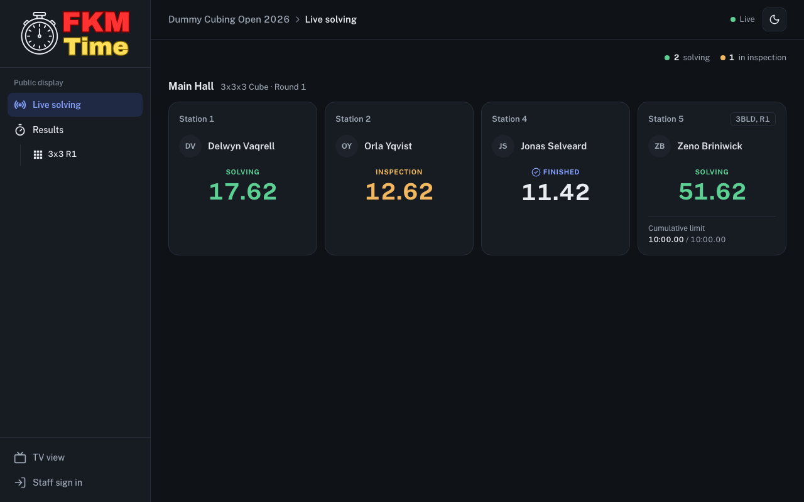
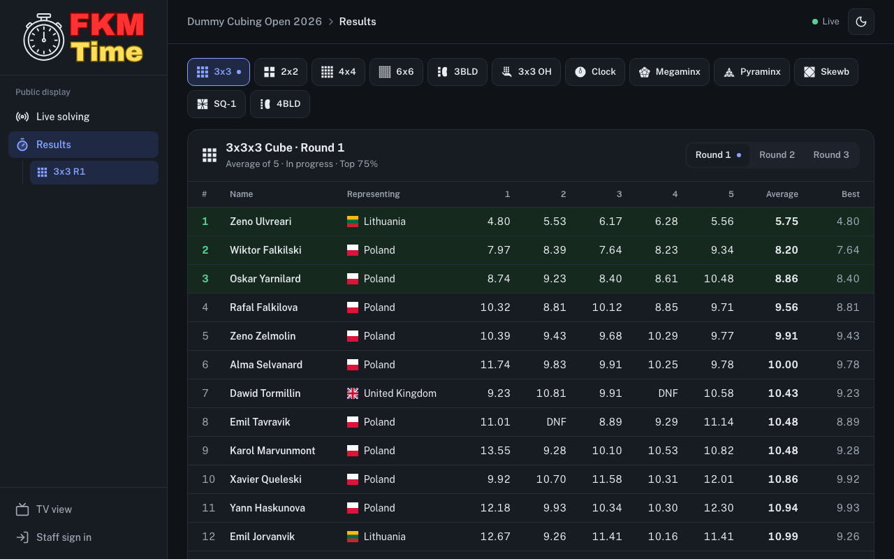
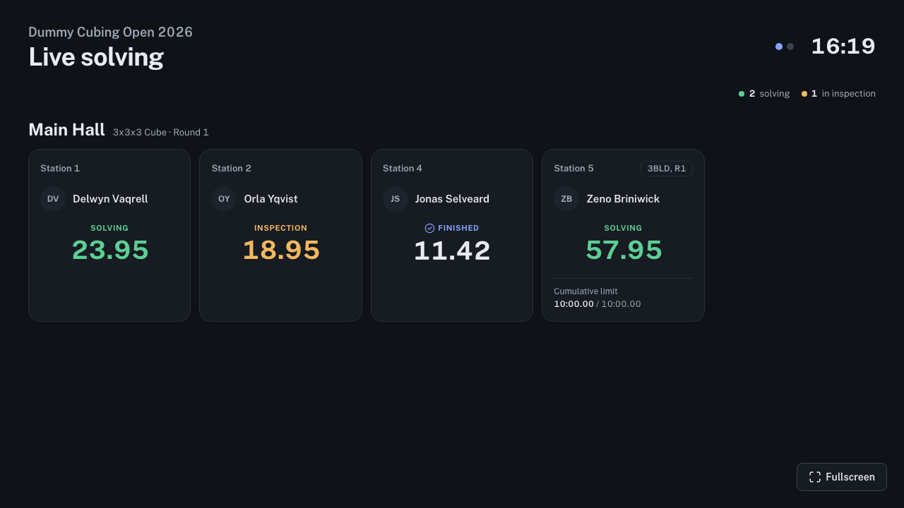
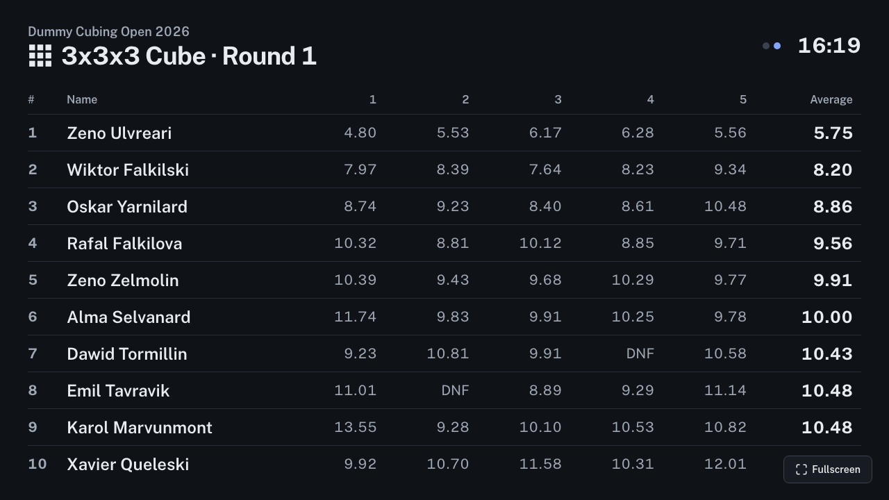
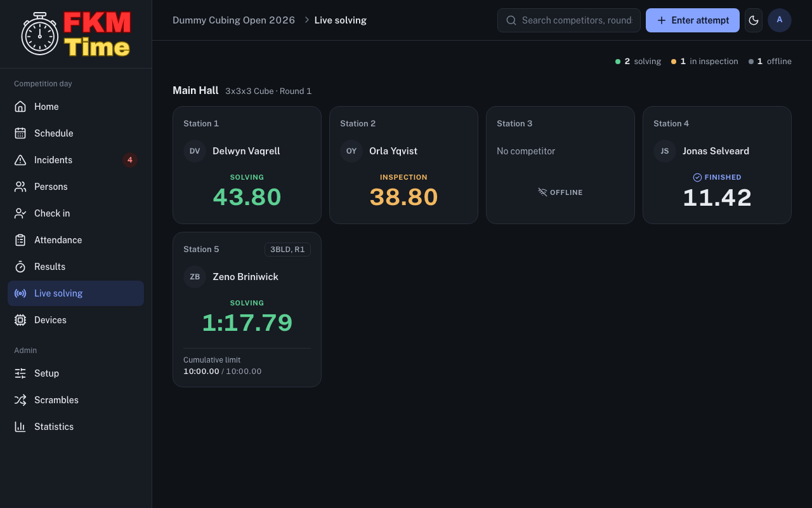

# Public display and live solving

FKMTime has screens for competitors and spectators: live times from the stations and the results of each round, updated as attempts come in. Anyone can open them without signing in. Signed-in staff get the same boards inside the panel.

Live times come from FKMTime stations, so these screens are meant for competitions that use FKMTime devices.

## Public display

**Who can use it:** anyone, no account needed.

Click **Public display** at the bottom of the sign-in page, or open `/public` on your FKMTime address. Share that link with competitors, for example on a QR code at the venue.

The sidebar has two items:

- **Live solving** - the station board, described [below](#the-station-board). When the stations span several rooms, you can pick one room or **All rooms**.
- **Results** - the results of every round. Rounds with a group in progress are listed under **Results** in the sidebar.

At the bottom of the sidebar, **TV view** opens the [TV view](#tv-view) and **Staff sign in** goes back to the sign-in page. On a phone the sidebar becomes two tabs, **Live solving** and **Results**, under the header.

The header shows **Live** while the page is connected, or **Reconnecting** when it lost the connection. Everything updates on its own, so there is no need to refresh.

### Results

Pick an event at the top. Events with a round in progress have a dot. When the event has more than one round, switch between them with the round buttons on the right; again, a dot marks the round in progress. Opening **Results** without picking anything shows the round in progress, or the first round when nothing is running.

Under the round's name you see its format, its status (**In progress**, the number of competitors, or **Not started**) and how many competitors advance. The table ranks everyone with their attempts, **Average** and **Best**; the top three are highlighted.

## TV view

**Who can use it:** anyone, no account needed.

The TV view is made for a projector or a TV at the venue. Open **TV view** from the public display, or `/public/tv` directly, and click **Fullscreen**.

It rotates on its own, every 15 seconds, between:

- **Live solving** - the station board for all rooms
- the results of each round in progress - the top 10, with their attempts and their average (or best, depending on the format)

The dots next to the clock show which slide is on screen. There is nothing to click: the **Fullscreen** button and the mouse cursor hide after a few seconds without mouse movement, and the page keeps the screen from going to sleep. If you have a keyboard at hand, the left and right arrow keys switch slides.

If the connection drops, a **Reconnecting** badge says when the screen was last updated.

## The station board

Live solving shows one card per station, grouped by room. Next to each room's name you see the round it runs. Above the cards, counters show how many stations are solving and how many are in inspection.

Each card shows the station's name, the competitor at it and its state:

- **Waiting** - no solve in progress
- **Inspection** - inspection is running, with the inspection time
- **Solving** - the timer is running, with the running time
- **Finished** - the solve has ended, with its time
- **Offline** - the station hasn't sent anything for 30 seconds

When the round has a cumulative time limit (for example in blindfolded events), the card shows **Cumulative limit**: the time the competitor has left, out of the whole limit. **Last solve** shows the station's last entered attempt. When a room runs more than one round, or a station is set to a round its room isn't running, the card also shows the station's round.

## Live solving in the panel

**Who can use it:** every signed-in user, when the competition uses FKMTime devices.

Click **Live solving** in the sidebar (or open `/results/live`). It's the same board, with a few additions for staff:

- every station is listed, also ones that haven't sent anything yet, and the counters include how many stations are **offline**
- for delegates and users with delegate access, when a station calls the delegate, its card gets a red border and an **Incident** badge, and the page plays a sound

## Public view of the results

**Who can use it:** every signed-in user, when the competition uses FKMTime devices.

The panel has a copy of the public results, called **Public view**. It works the same way as **Results** on the public display.

- Delegates open it from a round in **Results**: in the round's more actions menu (**…**), click **Public view**.
- Everyone else gets the public view when they click **Results** in the sidebar.

Signed-in users can also find **Public display** and **TV view** in the search at the top of the panel (on a computer; the phone layout has no search).
