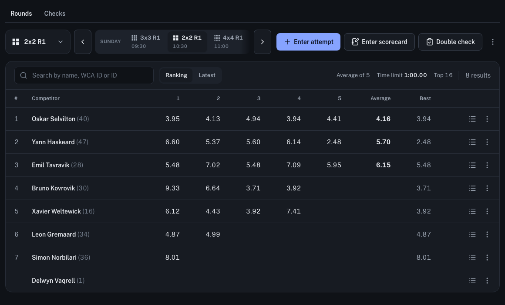
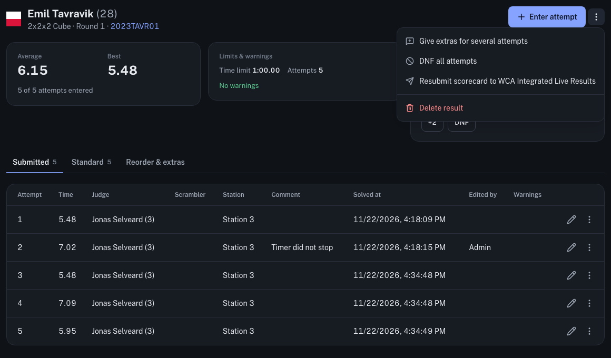
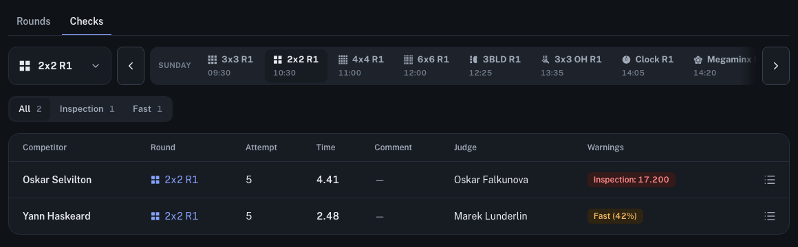

# Results

The **Results** page shows every round's results as FKMTime has them, and has the tools to fix them: entering a missed attempt, editing a wrong one, giving extras, DNF rulings and resubmitting results to the results website.

:::note Who can use it
Delegates (and admins). Everyone else gets **Results** as a read-only copy of the public results (the **Public view**). Someone with [delegate access](delegate-access.md) for a group can open the result of a competitor in that group, with only the actions their access includes.
:::

The page is there when the competition uses FKMTime devices. It has two tabs: **Rounds** and **Checks**.

## Rounds

Pick a round from the round list. The page opens on the round in progress, or the first round. The round's results are in a table with each attempt, the average and the best.

- **Search by name, WCA ID or ID** filters the table.
- **Ranking** orders the results by place, **Latest** by the most recently changed.
- The line above the table shows the round's format, time limit, cutoff and who proceeds to the next round.

Each row has **View attempts** (opens the result, see [A single result](#a-single-result)) and a menu with **Delete result**.

### WCA Integrated Live Results

When results go to WCA Integrated Live Results and FKMTime is connected to it, the round list shows the state of each round there (not open yet, open, done or needs attention), and each result shows how it is doing:

- **Sending** - on its way
- **Not accepted**, **Not in round** or **Can't be sent** - it isn't getting through; hover over the badge for the reason
- **Differs** - WCA live results holds other attempts than FKMTime
- **Advances** or **May advance** - the WCA's advancing flag

A row's menu also has **Clear in WCA live results** (empties the result there; FKMTime then sends its own again) and, in later rounds, **Remove from round** for a competitor who hasn't competed in it. Results that are only in WCA live results show up in the table too, with **Clear in WCA live results**.

### Round actions

Above the table:

- **Enter attempt** - opens a form to enter an attempt for any competitor of the round: **Competitor**, **Attempt**, the time, **Penalty**, **Outcome** and, under **More details**, **Judge**, **Scrambler**, **Station** and **Comment**. A time over the time limit is saved as DNF.
- **Enter scorecard** - type in a competitor's paper scorecard, attempt by attempt.
- **Double check** - go through the round's results one competitor at a time. It shows once the round has results.

**Enter scorecard** and **Double check** are described in [Double check and scorecards](double-check-and-scorecards.md).

The round's menu (⋮) has:

- **Public view** - the round as the public results show it.
- **Resubmit to WCA Live** (or to WCA Integrated Live Results, or Cubing Contests for unofficial events) - sends the whole round again, overwriting it there.
- When FKMTime is connected to WCA Integrated Live Results, actions for the round there, depending on its state: **Open in WCA Integrated Live Results**, **Add competitor to round** (first rounds), **Close in WCA Integrated Live Results**, **View on WCA live results** and **Clear in WCA Integrated Live Results**.
- **Restart group** - pick a group and confirm: all results from that group are deleted and its attendance is cleared. Use it when a group has to be run again.

## Entering an attempt quickly

**Enter attempt** at the top of every page (on phones, the floating button on the Results page) opens a keyboard-first form: pick one of the rounds in progress if the round isn't chosen already, type a competitor's name or registrant ID, the next attempt is picked for you, type the time, choose the **Penalty** (**None**, **+2**, **+4**, **DNF** or **DNS**) and press Enter to save. **Enter attempt** on a room's card on **Home** opens the same form for that room's round.

## A single result

**View attempts** opens a competitor's result in a round. You can also get there from an incident.

At the top:

- **Average** and **Best**, and how many attempts are entered.
- **Limits & warnings** - the time limit (and how much of a cumulative limit is used and remaining), the cutoff, the number of attempts, and warnings such as **Differs from WCA Live** or **Staffed before competing**.
- **Last attempt** - the latest attempt with its stackmat time, inspection and judge, buttons to edit it, give an extra or delete it, and **+2** and **DNF** to set its penalty in one click.
- **WCA live results** - only when FKMTime is connected to WCA Integrated Live Results: whether the result is **Confirmed**, **Sending**, **Differs** or **Not sent yet**, FKMTime's attempts next to the WCA's, and **Clear in WCA live results**.

The attempts are in tabs:

- **Submitted** - the attempts that count, as sent to the results website, with judge, scrambler, station, comment, when each was solved, who edited it and its warnings
- **Standard** and **Extra attempts** (when there are extras) - every attempt, also showing what replaced it and its status. **Standard** has **Swap attempts**, to swap two attempts that were entered in the wrong order
- **Reorder & extras** - drag attempts into the right order, and drag an extra onto the attempt it replaces

Each attempt has:

- **Edit attempt** - change the attempt number, time, penalty, outcome, judge, scrambler, station or comment. The result is resubmitted.
- **Edit history** - every change to the attempt: what changed, who changed it and when.
- **Give extra attempt** - the competitor gets an extra in place of this attempt. Add a comment or use a [quick action](incidents.md#quick-actions).
- **Delete attempt**, after you confirm.

### The result's menu

The **Enter attempt** button next to the competitor's name adds an attempt to this result. The menu (⋮) next to it has:

- **Give extras for several attempts** - when more than one attempt has to be redone, for example after a scramble mistake. Tick the **Attempts to replace**, choose **Extra scrambles** or a **Fresh set** (the normal scrambles of a set this competitor hasn't seen, like the next group's), add a comment and confirm. The page then shows the replaced attempts next to their extras, and you can switch which of them is **Counting**: the **Originals** or the **Extras**.
- **DNF all attempts** - a DNF ruling. Tick the attempts to set to DNF and add a comment. The times are kept. You can also DNF all the remaining attempts, so the competitor can't do any more. If the competitor has results in later rounds, **Remove results in later rounds (Regulation 9t)** removes them too. Afterwards the result shows the attempts **Ruled DNF** with **Restore original attempts** to undo the ruling.
- **Resubmit scorecard to WCA Live** (or the competition's results website) - sends this result again.
- **Assign DNS on remaining attempts** - when the competitor won't do the rest of their attempts.
- **Remove from this round (Regulation 9t)** - in later rounds, for a competitor who shouldn't have been in the round, for example after a score-taking mistake in the previous round. Give the **Reason** and confirm. The result then shows **Removed from this round under Regulation 9t** with **Bring back** to undo it.
- **Delete result** - deletes every attempt of the result.

**DNF all attempts** asks you to resolve the competitor's open [incident](incidents.md) first. **Give extras for several attempts** works with one open incident, which then gets its extra too, but not with more.

## Checks

**Checks** lists attempts worth a second look, for one round or **All rounds**. Filter them by type:

- **Inspection** - inspection over 15 seconds
- **Penalty** - a penalty bigger than +2
- **DNS**
- **Fast** - much faster than the competitor's other attempts in the round
- **Staffing** - the competitor was recorded as judging or scrambling before a later solve in the same group

**View attempts** opens the result, where you can fix the attempt.
