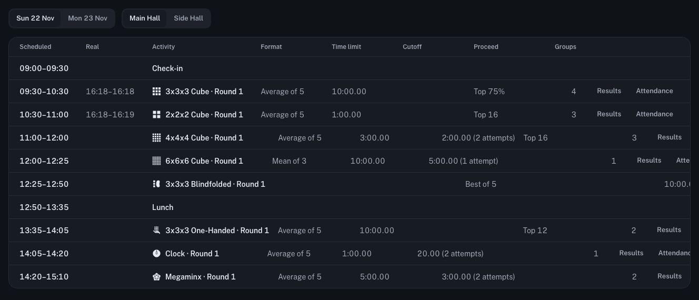
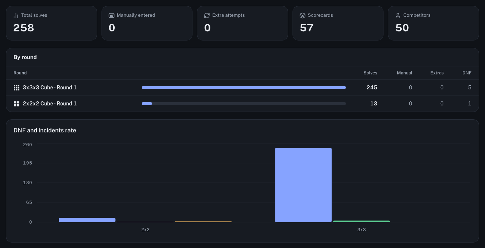
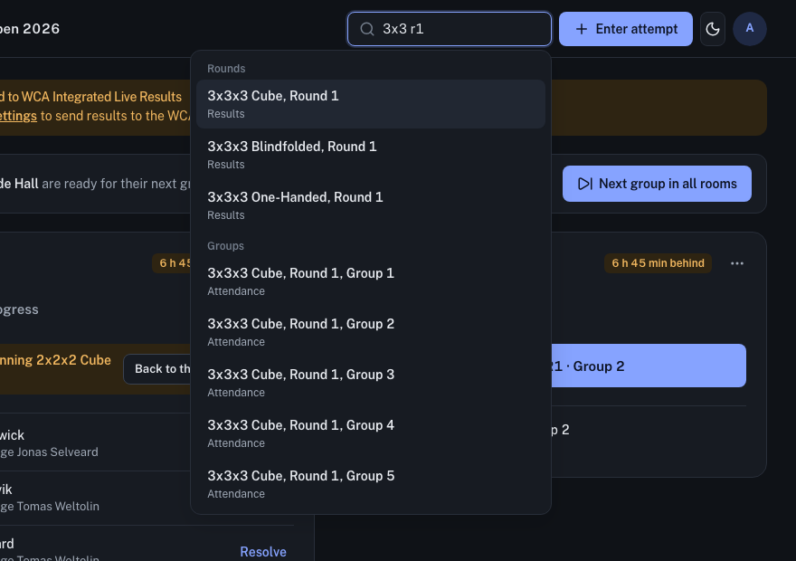

# Schedule, statistics and search

## Schedule

The **Schedule** page shows the competition schedule, room by room. Everyone signed in to the panel can open it.

Pick the **Day** and the **Room** at the top (they show only when the competition has more than one). On a competition day, the page opens on today.

Each activity shows:

- **Scheduled** - the time from the schedule
- **Real** - when the round really took place (see below)
- **Activity** - the event and round, or another activity such as a lunch break
- **Format**, **Time limit**, **Cutoff** and **Proceed** (how many competitors advance to the next round)
- **Groups** - how many groups the round has in this room

The activity taking place right now is highlighted (on a phone it gets a **Now** badge).

### Scheduled and real times

**Real** is worked out from the attempts sent from FKMTime stations: it runs from the first to the last station attempt of the round. While a round has only one such attempt, it shows **Started** and the time. Attempts entered by hand don't count, so a round entered only from paper scorecards has no real time. Compare it with **Scheduled** to see how far behind the schedule you are.

### Links to results and attendance

Next to each round there are links, depending on your role:

- **Results** - the round's results. Delegates, when the competition uses FKMTime devices.
- **Attendance** - the attendance of the round's first group in this room. Stage leaders, organizers and delegates. A stage leader gets it only for groups in their rooms (see [Stage leaders and rooms](../basic-knowledge/accounts.md#stage-leaders-and-rooms)).

## Statistics

The **Statistics** page shows how the competition is going. Organizers and delegates can open it when the competition uses FKMTime devices. It updates live as attempts come in.

At the top are the totals:

- **Total solves**
- **Manually entered** - attempts that didn't come from a station
- **Extra attempts**
- **Scorecards**
- **Competitors**

**By round** lists each round with its number of **Solves**, and how many were **Manual**, **Extras** and **DNF**.

On a computer, the page also has charts and lists:

- **DNF and incidents rate** - attempts, DNFs and incidents for each event
- **Delay for** each day - how far the first solve of each round was from its scheduled start, and the last solve from its scheduled end
- **Attempts by device** - how many attempts each station sent
- **Averages with single station & judge** - results where every attempt was done at the same station with the same judge
- **Judges mostly judging one competitor** - judges who judged one competitor for more than half of their attempts
- **Most judged attempts** and **Most scrambled attempts**

A chart without enough data shows **Not enough data yet**, and the lists show only when they have something in them.

## Search

The search box at the top of the panel, **Search competitors, rounds, pages…**, finds anything you can open. It is in the header on a computer.

Type at least 2 characters. Every word you type has to match, so `3x3 r1` finds 3x3x3 Cube Round 1. Results are grouped, at most 5 per group:

- **Pages** - the pages and tabs you can open, for example **Users** or **Most missed**, and the public screens (**Public display** and **TV view**)
- **Competitors** - by name or WCA ID; opens the person's page
- **Rounds** - opens the round's results (when the competition uses FKMTime devices)
- **Groups** - opens the group's attendance (stage leaders, organizers and delegates)
- **Incidents** - open incidents, by competitor or round (when you can see incidents)
- **Devices** - by name or ESP ID (organizers and delegates)

Use the arrow keys to move through the results, Enter to open the highlighted one and Escape to clear the search.
