# Scrambles

FKMTime can show scrambles on a laptop or tablet next to the scrambling table, instead of printed scramble sheets. The scrambler scans their own card, then each competitor's card, and signs every scramble they hand out. FKMTime records who scrambled which attempt and when, so a delegate can check it later, for example when an incident comes up.

You manage scrambles on the **Scrambles** page. Only delegates (and admins) can open it, and only when **Use FKMTime devices** is on in the competition settings. The page has three tabs: **Scramble sets**, **Import** and **Scrambling devices**.

## Importing scrambles

Generate the scrambles in TNoodle and export them as **encrypted** scrambles JSON. Remember the password you chose: FKMTime never stores it, and the scrambling device asks for it before it shows any scrambles.

Go to **Scrambles** → **Import** and drop the file on **Upload encrypted scrambles JSON** (or click it to pick the file). FKMTime checks the file and lists every round and set it found, for example **Set A · 5 scrambles · 2 extra**.

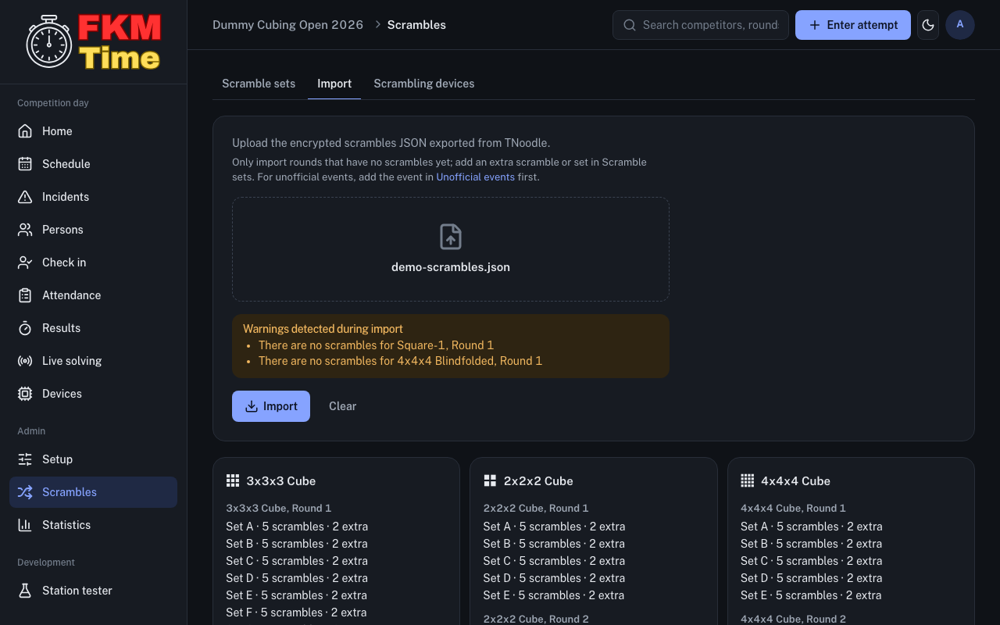

What the check can show:

- **Errors detected during import** - a set contains scrambles that aren't encrypted. You can't import the file until you export it again with encryption
- **Warnings detected during import** - a round has no scrambles, has a different number of sets than the competition expects, or has sets with an unusual number of scrambles or extras (for example a Bo3 round instead of Ao5). Warnings don't stop the import; check that they are intentional

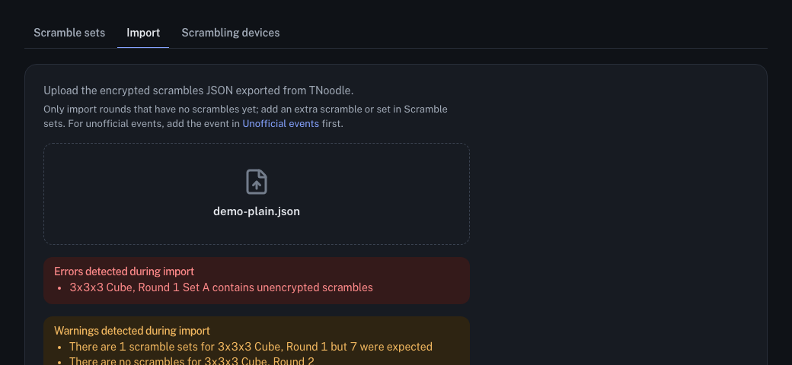

Events that aren't part of the competition are left out of the import. For an unofficial event, add it in **Unofficial events** first (see [Unofficial events](../basic-knowledge/unofficial-events.md)).

Click **Import** to save the scrambles, or **Clear** to pick another file. Only import rounds that don't have scrambles yet: if any set in the file was already imported, FKMTime refuses the whole file and tells you which set it was. To add more scrambles to a round later, use **Add scramble set** below.

## Scramble sets

The **Scramble sets** tab lists every round with the number of sets it has, or **Missing** if it has none yet. Click a round to see its sets and how many scrambles and extras each has.

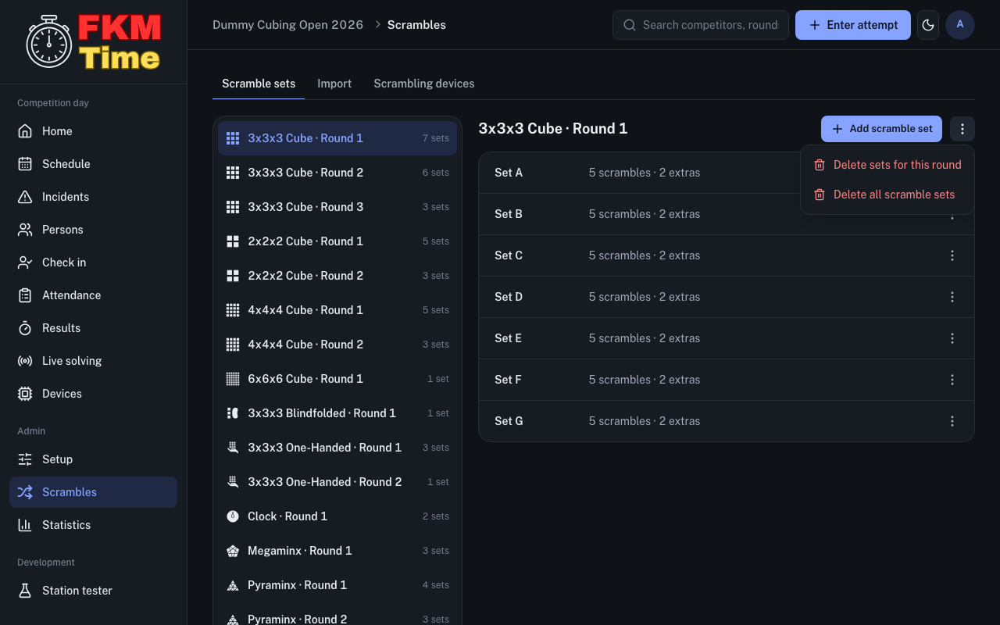

- **Add scramble set** - adds sets to the round, for example when you need a fresh set. In TNoodle, generate a file with only the new set, for this same event and round: FKMTime saves each set under the round named in the file. Upload it under **Upload scrambles** and click **Add**. The dialog says which letter the new sets start from
- **Delete scramble set** (in the set's menu) - deletes one set
- **Delete sets for this round** (in the menu next to **Add scramble set**) - deletes every set of the selected round
- **Delete all scramble sets** (same menu) - deletes the sets of every round, for example to start the import again

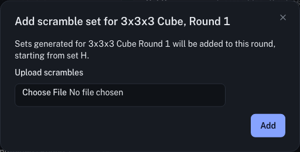

Deleting can't be undone; FKMTime asks you to confirm first.

## Scrambling devices

Every laptop or tablet used for scrambling is added as a scrambling device in a room. It offers **Scramble** only for rounds that are running in its room.

Go to **Scrambles** → **Scrambling devices** and click **Add device**. Enter a **Name**, choose the **Room** and click **Save**.

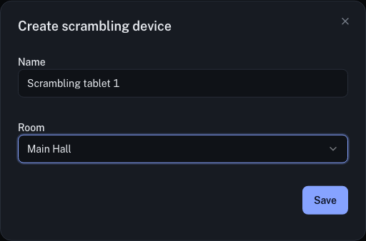

To sign the device in, click **One-time login code** (the key icon) next to it. FKMTime shows a 6-digit code. The code works for 10 minutes and only once. Opening the dialog again shows a new code and cancels the previous one. When a browser signs in with a new code, any browser signed in earlier as this scrambling device stops working and has to be signed in again.

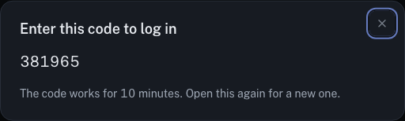

The device's menu has **Edit** (change name or room) and **Delete device**.

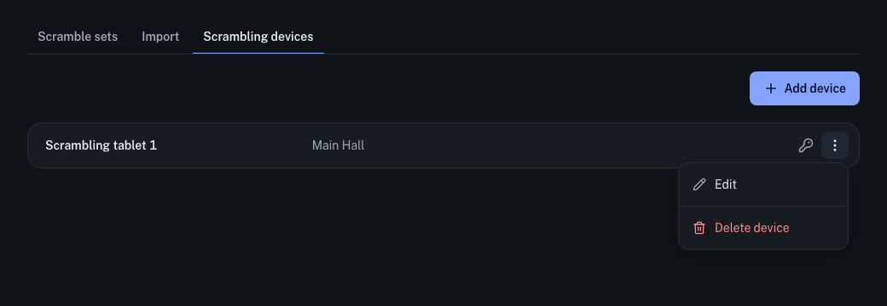

## On the scrambling device

The scrambling device is a laptop or tablet with a web browser and a card reader that types the card number and presses Enter (like a keyboard). You can also type the card number by hand and press Enter.

### Signing in

Open FKMTime on the device and click **Scrambling device** on the sign-in page. The button is there only when **Use FKMTime devices** is on.

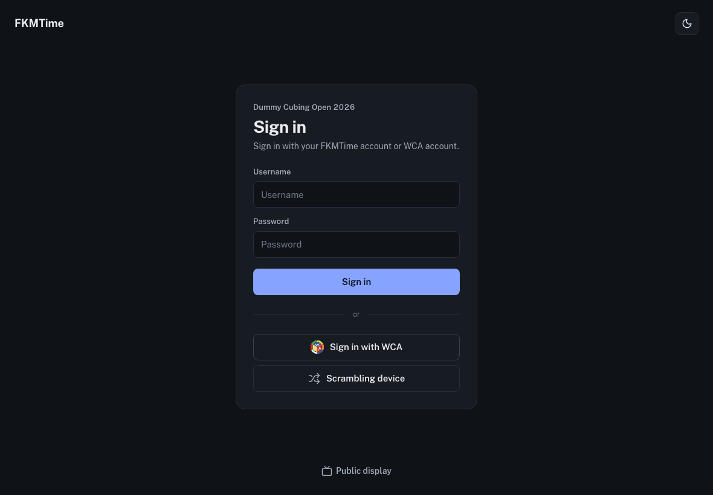

On the **Scrambling device** page, type the 6-digit code from **One-time login code** into the boxes. FKMTime sends it as soon as the sixth digit is typed (or click **Continue**). **Wrong code** means the code is mistyped, already used, replaced by a newer code, or older than 10 minutes. **Back to staff sign in** goes back to the usual sign-in.

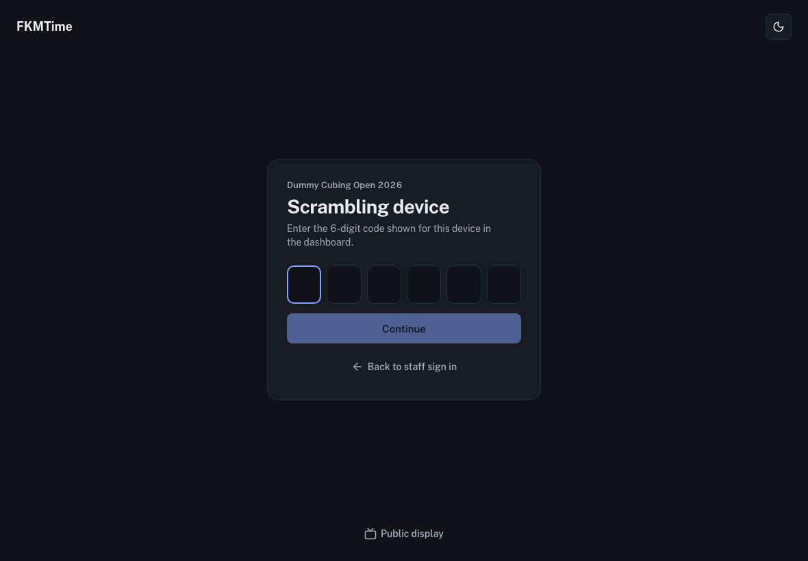

The device stays signed in until you click **Log out** on its home page, until it is signed in again with a new code, or until the device is deleted.

### Choosing a set

The home page, **Scramble sets**, shows the device's room in the header. Pick the event at the top; events and rounds running in the room are marked with a dot. When an event has more than one round, pick the round next to its name. Until you pick something, the device shows the round running in its room.

Under the round name you can see whether it's running in the room: **In progress in this room · Group 1**, **Running at** a station (when a delegate used **Run a different round…** on a station of this room, see [Managing devices](../basic-knowledge/adding-devices.md#managing-devices)), or **Not in progress in this room**.

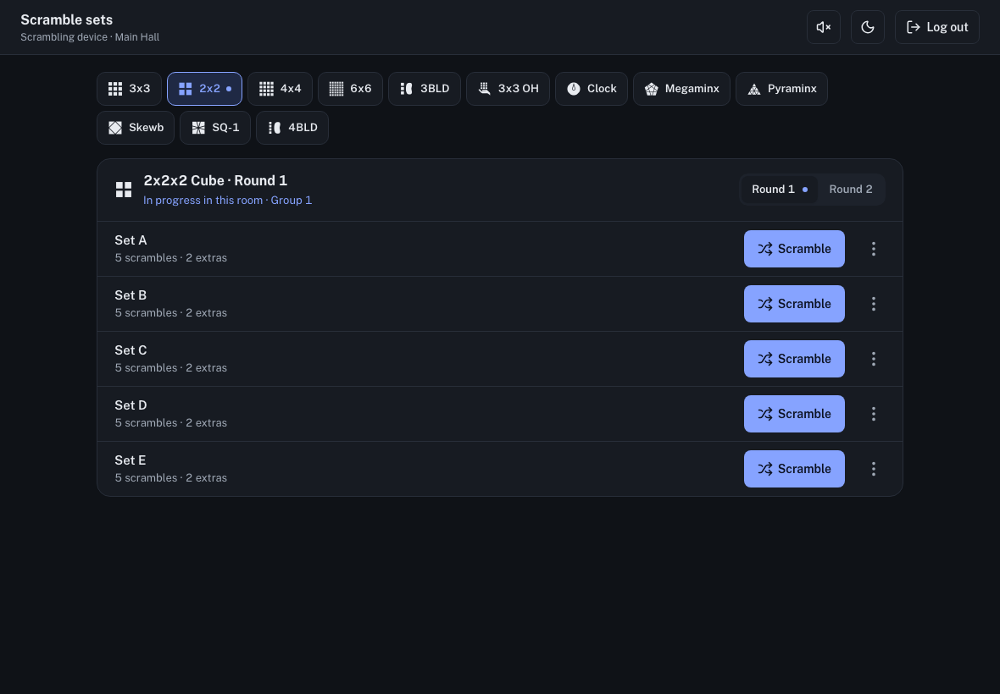

For a round that is running in the room, each set has a **Scramble** button. Its menu (⋮) has **All scrambles**. For other rounds, sets only have **All scrambles**.

### Scrambling

1. Click **Scramble** next to the set you are using.
2. Enter the password of the scrambles file and click **Unlock**. A wrong password shows **Invalid password**.

   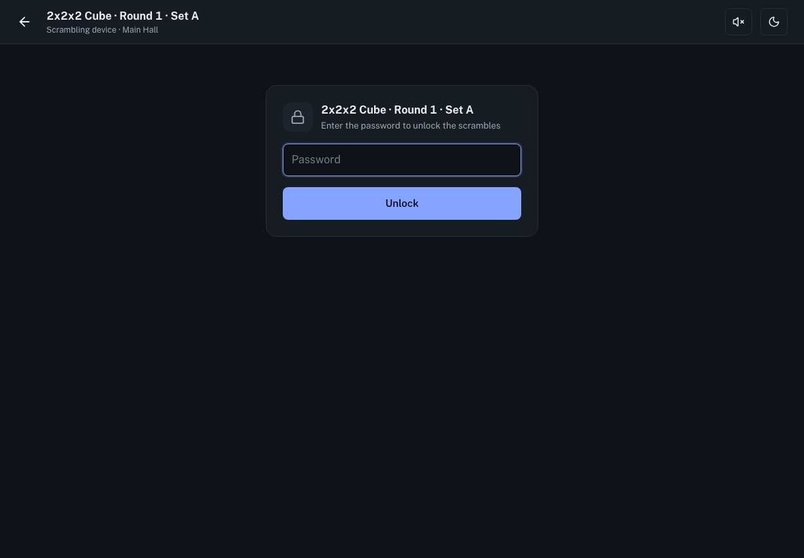

3. **Scan the scrambler's card.** The scrambler signs every attempt scrambled on this device, so they scan in each time a set is opened.

   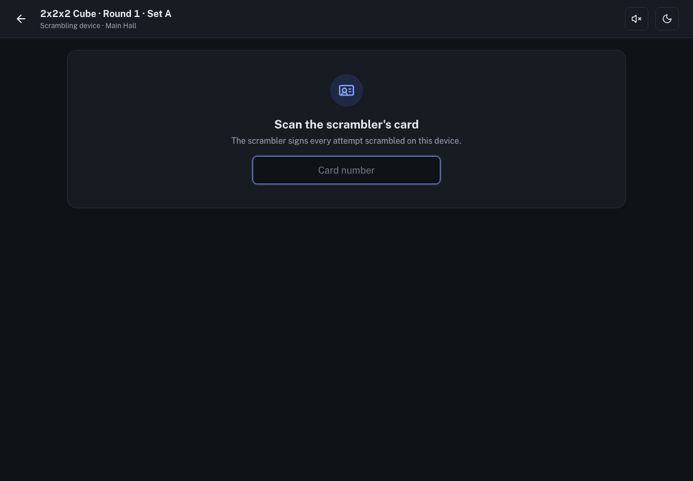

4. **Scan the competitor's card.** FKMTime picks the competitor's next attempt and shows its scramble: the competitor's name and WCA ID (or **Newcomer**), the scramble number (**Scramble 1**, or **Extra 1** for an extra attempt a delegate granted with **Extra scrambles**; when the delegate chose **Fresh set**, the device shows the normal **Scramble** number, so open a set the competitor hasn't used), the scramble and a picture of the scrambled puzzle.

   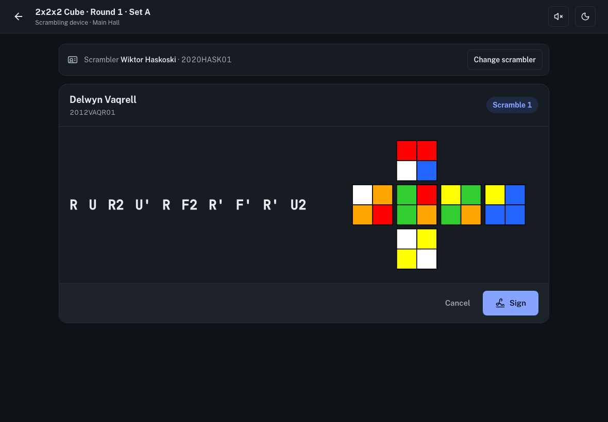

5. Scramble the puzzle and click **Sign**. **Cancel** goes back without signing.

After signing, the device shows **Last signed:** with the competitor and scramble number, and waits for the next competitor's card.

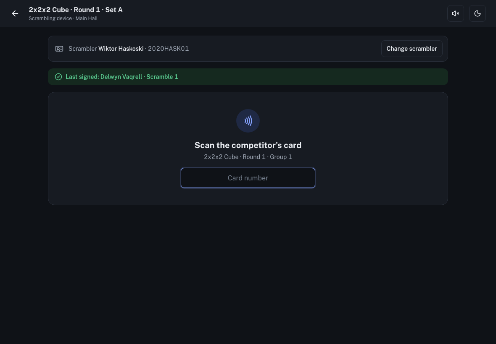

Signing records the attempt as scrambled by this scrambler, at this time. On the competitor's result page the attempt shows as **Scrambled, not solved yet**, with the scrambler in the **Scrambler** column, until the station sends the solve. If the competitor's card is scanned again before they solve, the device shows the same scramble again.

Messages you may see when scanning:

- **Scrambler not found** - no one has this card. Assign it on the **Persons** page (see [Assigning cards](../basic-knowledge/assigning-cards.md))
- **Competitor not found**
- **Scrambler and competitor cannot be the same**
- **No attempts left** - the competitor has done all attempts of the round

If you open a set of a round that isn't running in the room, the device warns: **This round isn't running in this room. Check that this is the right set before scrambling.** The device doesn't notice a group change while a set is open, so go back to the home page when the room moves on.

### Other options

- **Change scrambler** - when another person takes over scrambling; scan their card
- **All scrambles** - every scramble and extra of the set, after entering the password. Useful to check a scramble without signing anything

  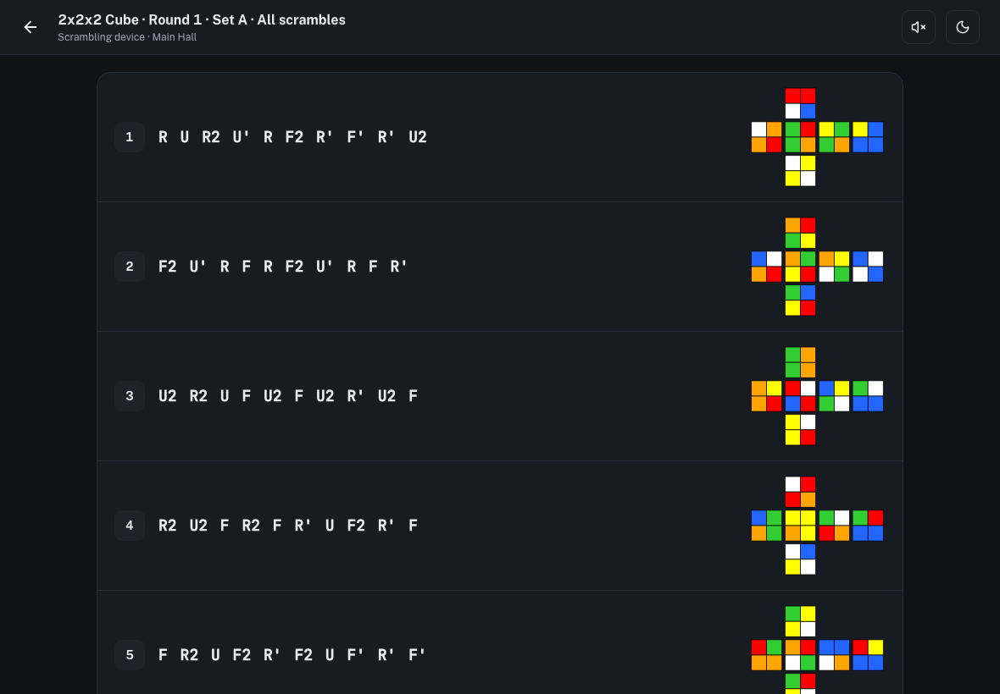

- **Scan sounds** (speaker icon in the header) - plays a sound on every successful or failed scan. It's off by default and saved on this device
- **Log out** - on the home page; the device needs a new one-time login code to sign in again
